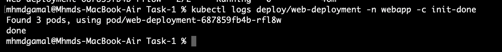
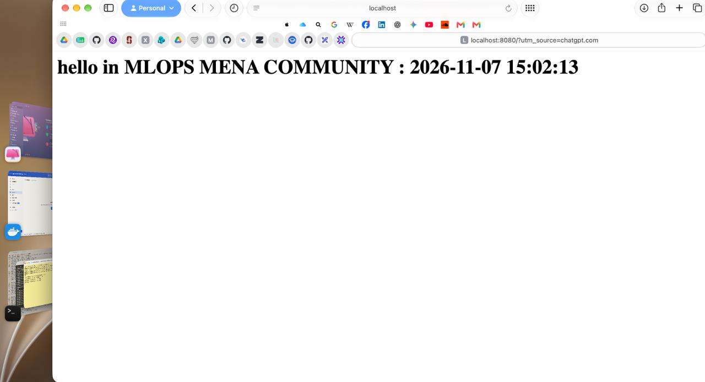
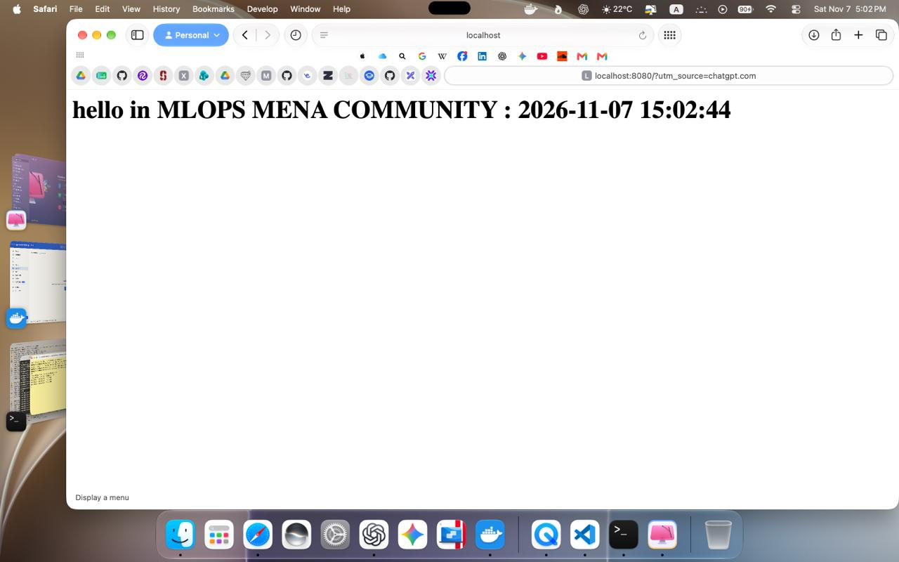
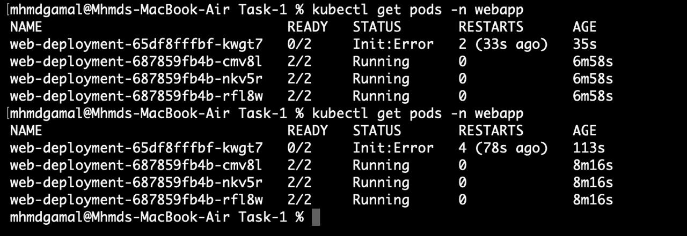
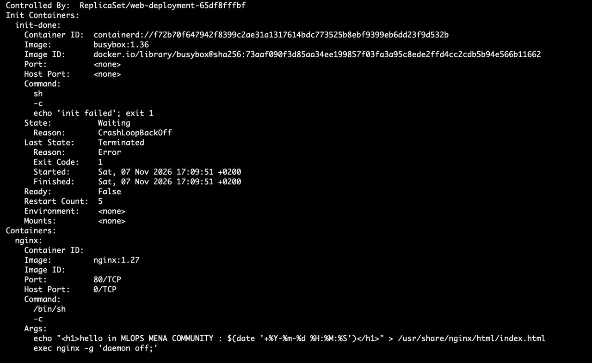
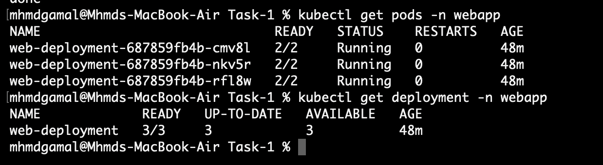

# Kubernetes Course - Task 1

## Multi-Container Pods (Init Container & Sidecar)

### Objective
Deploy an Nginx Hello page with a dynamically updated timestamp
on a 3-node Minikube Kubernetes cluster.

### Environment
- macOS Apple Silicon (M1)
- Docker Desktop
- Minikube
- Kubernetes
- Calico CNI

### Architecture
- Namespace: webapp
- Deployment: web-deployment
- Replicas: 3
- Init Container: init-done
- Main Container: nginx
- Sidecar Container: time-updater
- shareProcessNamespace: true
- No volumes

### Container Responsibilities

1. **init-done:** Prints "done" and exits successfully.
2. **nginx:** Creates index.html and serves the Hello page on port 80.
3. **time-updater:** Updates the timestamp every 5 seconds
   using /proc/<pid>/root.

### Deployment

Create the namespace:

`kubectl apply -f namespace.yaml`

Deploy the application:

`kubectl apply -f deployment.yaml`

Verify the Pods:

`kubectl get pods -n webapp`

Check the Init Container:

`kubectl logs deploy/web-deployment -n webapp -c init-done`

Access the Nginx page:

`kubectl port-forward -n webapp deploy/web-deployment 8080:80`

Open http://localhost:8080

### Failure Simulation

The Init Container was modified to exit with code 1.

`kubectl apply -f deployment-failure.yaml`

The new Pod failed during initialization.

Diagnosis confirmed:
- CrashLoopBackOff
- Exit Code: 1
- Repeated restart attempts
- No volumes
- Existing 3 Pods remained running

### Recovery

Restore the working Deployment:

`kubectl apply -f deployment.yaml`

Verify recovery:

`kubectl get pods -n webapp`

`kubectl get deployment -n webapp`

Final result:
- READY: 3/3
- UP-TO-DATE: 3
- AVAILABLE: 3

### Screenshots

#### 1. Three Ready Nodes

#### 2. Running Pods

#### 3. Init Container Success

#### 4. Timestamp Before Update

#### 5. Timestamp After Update

#### 6. Init Container Failure

#### 7. CrashLoopBackOff Diagnosis

#### 8. Successful Recovery

