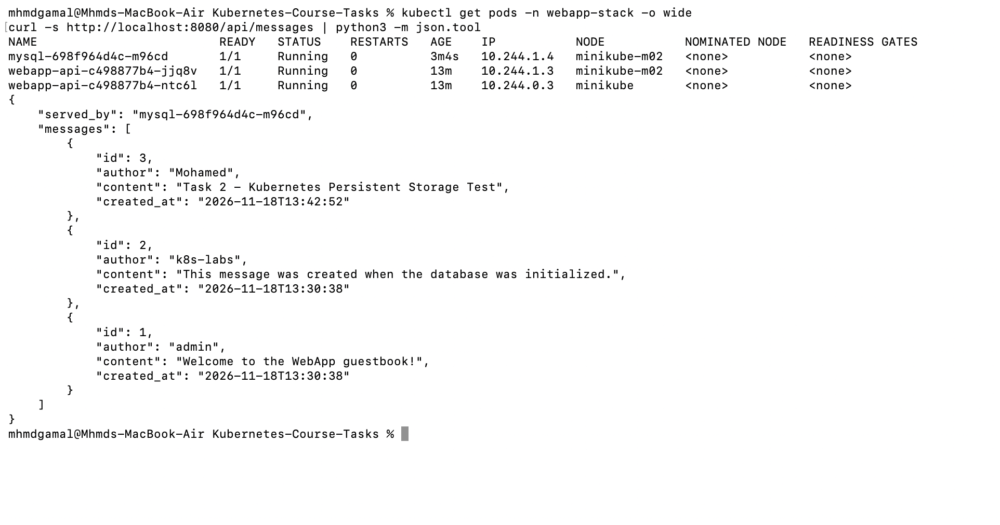
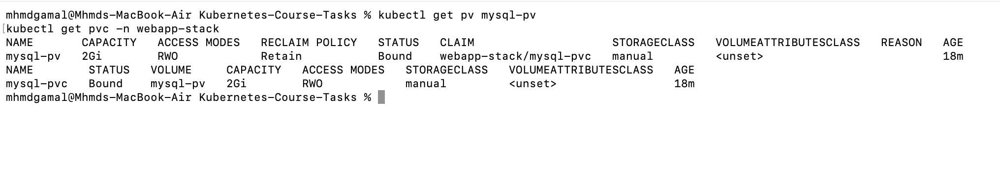
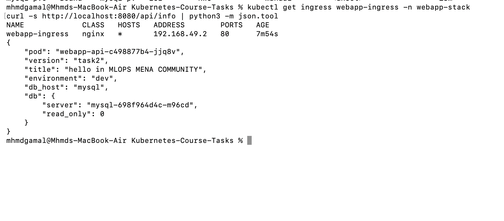

# Task 2 — FastAPI + MySQL on Kubernetes

**MLOps MENA Community · Kubernetes Course · Session 2**

## Overview

This task deploys the instructor-provided **FastAPI guestbook** and **MySQL** application to a local, multi-node Minikube cluster. Kubernetes ConfigMaps and Secrets supply configuration, a PersistentVolume and PersistentVolumeClaim keep MySQL data available after a Pod is recreated, and an NGINX Ingress exposes the FastAPI application.

**Implemented and verified:**

- A dedicated namespace: `webapp-stack`
- FastAPI Deployment with **2 replicas** and an internal ClusterIP Service
- MySQL Deployment with **1 replica** and an internal ClusterIP Service
- Application settings through a **ConfigMap** and credentials through a **Secret**
- **2Gi PersistentVolume (PV)** and **PersistentVolumeClaim (PVC)** with `Bound` status
- Storage node affinity pinning MySQL to the `minikube-m02` worker node
- **NGINX Ingress** routing HTTP requests to the FastAPI Service
- Successful API reads/writes and **persistence after deleting the MySQL Pod**

The application source code comes from the [MLOps MENA Community Kubernetes Course Tasks](https://github.com/MLOpsMENACommunity/Kubernetes-Course-Tasks/tree/master/task-session-2). The Kubernetes manifests and deployment steps are part of this task submission.

## Architecture

```text
Browser / curl
      |
      v
NGINX Ingress Controller
      |
      v
webapp-ingress (path: /)
      |
      v
webapp-api Service (ClusterIP, port 80)
      |
      +-------------------------------+
      |                               |
      v                               v
FastAPI Pod 1                    FastAPI Pod 2
(container port 8000)            (container port 8000)
      |                               |
      +---------------+---------------+
                      |
                      v
             mysql Service (3306)
                      |
                      v
            MySQL Deployment (1 Pod)
                      |
                      v
             mysql-pvc (2Gi, RWO)
                      |
                      v
              mysql-pv (2Gi)
                      |
                      v
           minikube-m02 worker node
```

The PV uses a local `hostPath` volume for this **Minikube learning environment**, with `nodeAffinity` for `minikube-m02`. This design is suitable for a local lab, not production-grade shared storage.

## Prerequisites

- Docker
- Minikube
- `kubectl`
- A terminal and `curl`

The commands below are run from the **`Task-2/`** directory, unless otherwise stated.

## Deployment

### 1. Start the two-node cluster and enable Ingress

```bash
minikube start --driver=docker --nodes=2 --cpus=2 --memory=2000
minikube addons enable ingress
kubectl get nodes -o wide
kubectl rollout status deployment/ingress-nginx-controller -n ingress-nginx --timeout=180s
```

> This was tested with Minikube's Docker driver on macOS. On a smaller machine, allow extra time for images and Pods to become ready.

### 2. Build Docker images and load them into Minikube

```bash
chmod -x mysql/initdb/01-setup.sh

docker build -t webapp-api:task2 ./webapp
docker build -t webapp-mysql:task2 ./mysql

minikube image load webapp-api:task2
minikube image load webapp-mysql:task2
```

The Deployments use these local image tags with `imagePullPolicy: IfNotPresent`.

### 3. Create the namespace and configure the Secret

```bash
kubectl apply -f namespace.yaml
cp mysql-secret.example.yaml mysql-secret.yaml
```

Edit `mysql-secret.yaml` to replace `CHANGE_ME_ROOT_PASSWORD` and `CHANGE_ME_APP_PASSWORD` with passwords you choose. Keep the keys and resource name unchanged. **Do not commit `mysql-secret.yaml` to Git.**

```bash
kubectl apply -f mysql-secret.yaml
kubectl apply -f configmap.yaml
```

The tracked `mysql-secret.example.yaml` is a template only. **Do not apply the example directly** with placeholder passwords.

### 4. Deploy MySQL and persistent storage

```bash
kubectl apply -f mysql-pv.yaml
kubectl apply -f mysql-pvc.yaml
kubectl apply -f mysql-deployment.yaml
kubectl apply -f mysql-service.yaml

kubectl rollout status deployment/mysql -n webapp-stack --timeout=180s
kubectl get pv mysql-pv
kubectl get pvc -n webapp-stack
```

Both `mysql-pv` and `mysql-pvc` should show **`Bound`**.

### 5. Deploy FastAPI

```bash
kubectl apply -f webapp-deployment.yaml
kubectl apply -f webapp-service.yaml

kubectl rollout status deployment/webapp-api -n webapp-stack --timeout=120s
kubectl get pods -n webapp-stack -o wide
```

Expected: two ready FastAPI Pods and one ready MySQL Pod.

### 6. Configure NGINX Ingress

```bash
kubectl apply -f webapp-ingress.yaml
kubectl get ingress webapp-ingress -n webapp-stack
```

For **macOS + Minikube with the Docker driver**, use a port-forward to the **Ingress Controller** (rather than directly to the FastAPI Service):

```bash
kubectl port-forward -n ingress-nginx svc/ingress-nginx-controller 8080:80
```

Keep that terminal running. Open **http://localhost:8080** in a browser, or run the API tests below from another terminal.

## API Tests

### Application and database information

```bash
curl -s http://localhost:8080/api/info | python3 -m json.tool
```

The response should contain `"version": "task2"`, the ConfigMap-derived title and environment, and MySQL server details.

### Read guestbook messages

```bash
curl -s http://localhost:8080/api/messages | python3 -m json.tool
```

On a fresh database, two default guestbook messages are returned.

### Create a message

```bash
curl -X POST http://localhost:8080/api/messages \
  -H "Content-Type: application/json" \
  -d '{"author":"Mohamed","content":"Task 2 - Kubernetes Persistent Storage Test"}'
```

In the completed test, the API returned message **ID `3`**, written to the original MySQL Pod `mysql-698f964d4c-t48nw`.

## Persistence and Self-Healing Test

Delete **only** the MySQL Pod, leaving the Deployment, PV, and PVC intact:

```bash
kubectl delete pod -n webapp-stack -l app=mysql
kubectl rollout status deployment/mysql -n webapp-stack --timeout=180s
kubectl get pods -n webapp-stack -o wide
```

Then check the messages again:

```bash
curl -s http://localhost:8080/api/messages | python3 -m json.tool
```

**Observed result:** Kubernetes replaced MySQL Pod `mysql-698f964d4c-t48nw` with `mysql-698f964d4c-m96cd` on `minikube-m02`. The new Pod reached `1/1 Running`, and **message ID `3` was still present** alongside the two initial messages. This demonstrates both Kubernetes Deployment self-healing and data persistence through the PVC/PV.

## Screenshots / Evidence

### 1. Data persistence after MySQL Pod deletion

The replacement MySQL Pod is running, and the previously inserted message remains available.



### 2. PV and PVC are Bound

The `mysql-pv` and `mysql-pvc` are bound with a capacity of **2Gi**.



### 3. Ingress and API verification

The `webapp-ingress` resource uses the `nginx` class, and `/api/info` returns the expected application, ConfigMap, and database information.



## Key Kubernetes Resources

| Resource | Name | Purpose |
|---|---|---|
| Namespace | `webapp-stack` | Isolates task resources |
| ConfigMap | `webapp-config` | App title/environment and database connection settings |
| Secret | `mysql-secret` | MySQL credentials (local file excluded from Git) |
| Deployment | `mysql` | One MySQL replica |
| Service | `mysql` | Internal database access on port `3306` |
| PersistentVolume | `mysql-pv` | 2Gi storage on `minikube-m02` |
| PersistentVolumeClaim | `mysql-pvc` | Claims the MySQL storage |
| Deployment | `webapp-api` | Two FastAPI replicas |
| Service | `webapp-api` | Internal HTTP access on port `80` |
| Ingress | `webapp-ingress` | Routes `/` to the FastAPI Service |

## Notes

- The PV uses `ReadWriteOnce`, storage class `manual`, and reclaim policy `Retain`.
- `Retain` does **not** mean Kubernetes will automatically reuse the volume after deleting and recreating the PVC; reclaiming a released PV may require manual action.
- Local `hostPath` storage and the demonstration database credentials are intended for learning, **not production**.
- The Git-ignored `mysql-secret.yaml` must be created locally from `mysql-secret.example.yaml` before a fresh deployment.
- **Keep the Minikube cluster and stack available for Task 3**; do not run `minikube delete` after this task.
